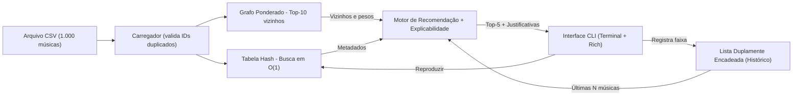
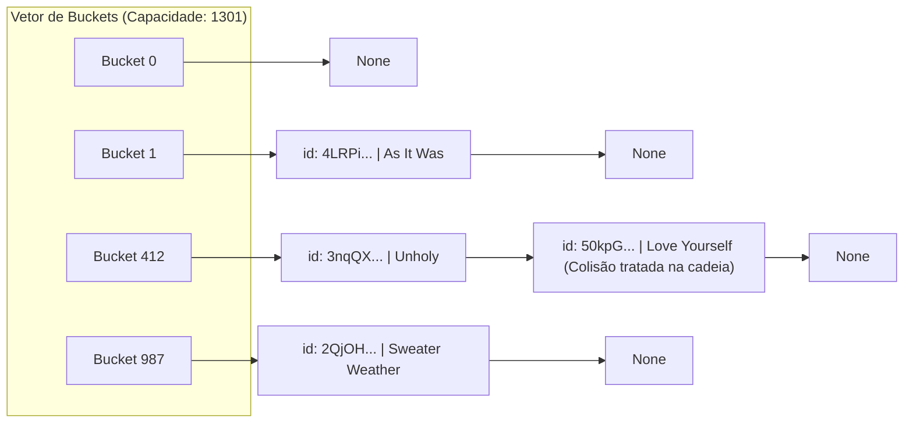
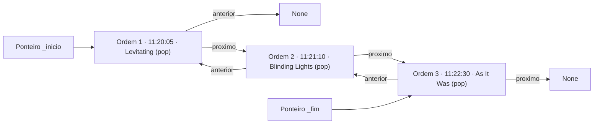
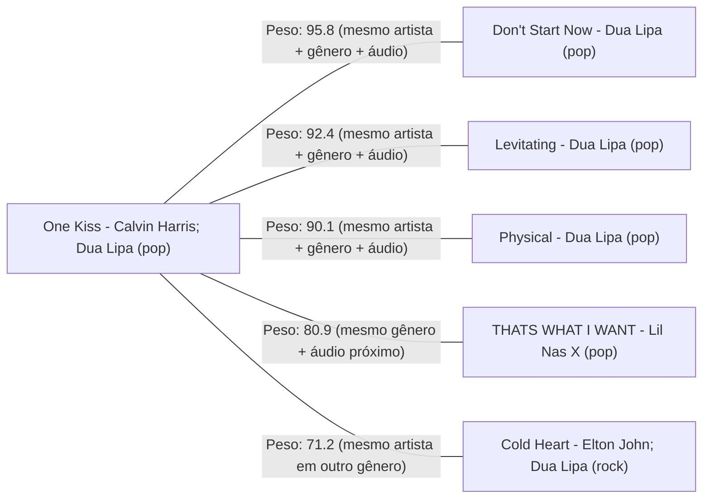
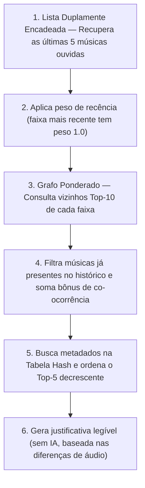

# Sistema de Recomendação de Músicas — Estruturas de Dados

> **Material de Apoio para Apresentação** · Disciplina: **Estruturas de Dados** (Prof. Lídio Campos)  
> Aplicação em Python que recomenda músicas com base em similaridade sonora e histórico de reprodução, utilizando **Tabela Hash**, **Lista Duplamente Encadeada** e **Grafo Ponderado** implementados do zero.

---

## Roteiro Visual da Apresentação

| Ordem | Tema | Responsável |
| :---: | :--- | :--- |
| **1** | Problema, Base de Dados e Arquitetura Geral | Edimax Junior |
| **2** | Tabela Hash com Encadeamento Separado | Edimax Junior |
| **3** | Lista Duplamente Encadeada (Histórico) | Anderson Lima |
| **4** | Grafo Ponderado e Cálculo de Afinidade | Anderson Lima |
| **5** | Motor de Recomendação, Explicabilidade e Demonstração | Paulo Brito |
| **6** | Testes, Casos-Limite, Limitações e Melhorias | Paulo Brito |

---

## 1. Problema, Contexto e Base de Dados

### O Problema
Plataformas de streaming precisam lidar com catálogos extensos e resolver três desafios em tempo real:
1. **Localizar faixas instantaneamente** sem percorrer todo o catálogo;
2. **Registrar o histórico de reprodução** em ordem cronológica e consultar as últimas músicas ouvidas;
3. **Recomendar músicas coerentes** com o gosto do usuário, explicando o *porquê* de cada sugestão.

### Base de Dados e Persistência Leve
- **Origem:** *Spotify Tracks Dataset* (Kaggle), originalmente com **114.000 faixas**.
- **Filtragem estratificada (`1.000` músicas):** selecionamos **10 gêneros** distintos (`pop`, `rock`, `hip-hop`, `mpb`, `electronic`, `indie`, `metal`, `sertanejo`, `r-n-b`, `reggaeton`) e extraímos as **100 faixas mais populares** de cada um, sem IDs repetidos.
- **Por que CSV + Memória RAM?** O arquivo [dados/musicas_1000.csv](dados/musicas_1000.csv) faz o papel de armazenamento permanente leve; ao iniciar, tudo é indexado diretamente nas nossas próprias estruturas de dados em memória.

### Arquitetura Geral do Sistema



---

## 2. Tabela Hash com Encadeamento Separado

> Implementação própria em [src/estruturas/tabela_hash.py](src/estruturas/tabela_hash.py) (sem usar `dict` como estrutura principal).

### Decisões de Projeto
- **Chave escolhida (`id` único da música):** músicas diferentes podem ter o mesmo título (inclusive duas versões da mesma faixa no Spotify, como ocorre no CSV com `STAY (with Justin Bieber)` em dois IDs distintos). Usar o `id` evita sobrescrita e ambiguidade.
- **Função de espalhamento (`_hash`):** hash polinomial sobre os caracteres do `id`:
  `h = (h * 31 + ord(caractere)) % 1301`
- **Capacidade prima (`1301` buckets):** mantém o fator de carga abaixo de `0.8` para 1.000 registros.
- **Tratamento de colisões:** **Encadeamento Separado** — cada posição do vetor aponta para uma lista encadeada de nós `_NoHash(chave, valor, proximo)`.

### Representação Gráfica (Buckets e Colisão)



### Métricas Reais e Complexidade

| Métrica Observada (`musicas_1000.csv`) | Valor | Operação | Caso Médio | Pior Caso |
| :--- | :---: | :--- | :---: | :---: |
| Capacidade do vetor | `1301` buckets | `inserir(id, musica)` | $O(1)$ | $O(n)$ |
| Elementos armazenados | `1000` faixas | `buscar(id)` | $O(1)$ | $O(n)$ |
| Fator de carga ($\alpha = n / m$) | `0.7686` | `remover(id)` | $O(1)$ | $O(n)$ |
| Colisões ocorridas / Maior cadeia | `299` colisões / `5` nós | — | — | — |

---

## 3. Lista Duplamente Encadeada — Histórico

> Implementação própria em [src/estruturas/lista_encadeada.py](src/estruturas/lista_encadeada.py) com nós `NoHistorico`.

### Por que Lista Duplamente Encadeada?
- O histórico cresce dinamicamente conforme o usuário ouve novas faixas.
- Mantendo ponteiros diretos para `_inicio` e `_fim`:
  - **Registrar uma reprodução** no final custa **$O(1)$** (sem realocar vetor);
  - **Recuperar as últimas $N$ músicas** (para alimentar o motor de recomendação) custa **$O(N)$**, bastando caminhar do `_fim` para trás pelo ponteiro `anterior`.

### Representação Gráfica dos Ponteiros



---

## 4. Grafo Ponderado de Similaridade

> Implementação própria em [src/estruturas/grafo.py](src/estruturas/grafo.py) com **Lista de Adjacência**.

### Lista de Adjacência vs. Matriz de Adjacência
Conectamos cada música apenas às suas **Top-10 vizinhas mais semelhantes** (grafo esparso):
- **Matriz de Adjacência:** exigiria $1.000 \times 1.000 = 1.000.000$ de células ($O(V^2)$), com **99% vazias**.
- **Lista de Adjacência:** armazena apenas $1.000 \times 10 = 10.000$ arestas ($O(V + E)$), economizando memória e acelerando a consulta de vizinhos.

### Matemática da Afinidade (Peso de `0` a `100`)

Cada música é posicionada com base em três atributos normalizados em $[0, 1]$: **`energia` ($E$)**, **`dancabilidade` ($D$)** e **`valencia` ($V$)**.

1. **Distância Euclidiana sonora:**
   $$D(A, B) = \sqrt{(E_A - E_B)^2 + (D_A - D_B)^2 + (V_A - V_B)^2}$$
2. **Similaridade de áudio:**
   $$\text{SimAudio}(A, B) = \frac{1}{1 + D(A, B)} \in (0, 1]$$
3. **Peso final da aresta (quanto maior, mais parecida):**
   - Até **60 pontos**: $60 \times \text{SimAudio}(A, B)$
   - **+25 pontos**: mesmo gênero musical
   - **+15 pontos**: mesmo artista

### Representação Gráfica do Grafo (Exemplo de Vizinhança)



### Estrutura Interna na Lista de Adjacência

```text
_adjacencias[id_musica] ──▶ [ Aresta(destino_1, peso=95.8), Aresta(destino_2, peso=92.4), ..., Top-10 ]
```

| Métrica do Grafo (`musicas_1000.csv`) | Valor |
| :--- | :---: |
| Total de vértices | `1000` |
| Total de arestas direcionadas | `10000` |
| Grau médio por vértice | `10.0` |
| Vértices isolados | `0` |

---

## 5. Motor de Recomendação e Explicabilidade

> Implementação em [src/motor_recomendacao.py](src/motor_recomendacao.py).

### Fluxo Integrado das Três Estruturas



### Como funciona a Explicabilidade (Diferencial)
Para cada recomendação, o sistema lê o dicionário `detalhes` da aresta no grafo e traduz os números em frases claras:
- `mesmo_artista == True` $\rightarrow$ *"Mesmo artista (...)"*
- `mesmo_genero == True` $\rightarrow$ *"Mesmo gênero musical (...)"*
- `diff_energia <= 0.08` $\rightarrow$ *"Nível de energia muito próximo"*
- `diff_dancabilidade <= 0.08` $\rightarrow$ *"Dançabilidade muito próxima"*
- `diff_valencia <= 0.08` $\rightarrow$ *"Clima/valência equivalente"*
- Co-ocorrência no histórico $\rightarrow$ *"Compatível com X músicas do seu histórico"*

---

## 6. Casos-Limite, Testes, Limitações e Melhorias

### Casos-Limite Tratados
- **Histórico vazio:** solicitar recomendações ou listar histórico exibe aviso amigável sem erro.
- **Música inexistente na busca:** exibe mensagem clara e sugere títulos parecidos por aproximação.
- **ID duplicado no CSV:** a `TabelaHash` rejeita duplicatas e o carregador contabiliza sem interromper a execução.
- **Vértice isolado no Grafo:** retorna lista vazia e exibe mensagem adequada na interface.
- **Entradas inválidas no menu:** validação numérica e tratamento de interrupção (`Ctrl+C`).

### Testes Automatizados (`pytest -v`)
**21 testes aprovados** cobrindo todas as camadas:
- [tests/test_tabela_hash.py](tests/test_tabela_hash.py) — inserção, busca, remoção, colisões forçadas, duplicatas e carga real de 1.000 faixas.
- [tests/test_lista_encadeada.py](tests/test_lista_encadeada.py) — lista vazia, ordem cronológica/inversa, últimas faixas únicas e limpeza.
- [tests/test_grafo.py](tests/test_grafo.py) — fórmula de afinidade, limite Top-K, vértice isolado e grafo completo de 1.000 vértices.
- [tests/test_motor.py](tests/test_motor.py) — exclusão de já ouvidas, explicabilidade, busca aproximada e casos de erro.
- [tests/test_carregador.py](tests/test_carregador.py) — tolerância a IDs duplicados na leitura do CSV.

### Limitações Atuais e Melhorias Futuras
- **Limitações:** catálogo estático de 1.000 músicas; histórico salvo apenas em memória durante a sessão; ausência de filtragem colaborativa (comparação entre múltiplos usuários).
- **Melhorias futuras:** persistência do histórico em JSON; interface web (ex.: Streamlit) com visualização interativa do grafo; inclusão de mais atributos musicais (como `tempo`/BPM e `acousticness`) e deduplicação de versões alternativas da mesma faixa.

---

## 7. Guia Rápido de Execução

```bash
# 1. Instalar dependências de apoio
pip install -r requirements.txt

# 2. (Opcional) Regerar a base filtrada a partir do Kaggle
python scripts/preparar_dataset.py

# 3. Rodar os testes automatizados
pytest -v

# 4. Iniciar a aplicação no terminal
python main.py
```

### Estrutura de Pastas

```text
recomendacao_de_musicas/
├── dados/musicas_1000.csv          # Base estratificada (10 gêneros x 100 faixas)
├── scripts/preparar_dataset.py     # Filtro e limpeza do dataset bruto
├── src/
│   ├── modelos.py                  # Dataclass Musica
│   ├── carregador.py               # Leitura do CSV e carga inicial
│   ├── motor_recomendacao.py       # Integração e explicabilidade
│   ├── cli.py                      # Interface no terminal com Rich
│   └── estruturas/
│       ├── tabela_hash.py          # Tabela Hash com encadeamento separado
│       ├── lista_encadeada.py      # Lista Duplamente Encadeada (histórico)
│       └── grafo.py                # Grafo Ponderado (lista de adjacência)
├── tests/                          # 21 testes unitários e de integração
├── main.py                         # Ponto de entrada
├── PLANO_DE_IMPLEMENTACAO.md       # Plano incremental do projeto
├── ROTEIRO_APRESENTACAO.md         # Divisão detalhada de falas (3 integrantes)
└── README.md                       # Material de apoio visual da apresentação
```

---

## 8. Fontes, Bibliotecas e Materiais Consultados

- **Dataset:** *Spotify Tracks Dataset* (Maharshi Pandya, Kaggle — `maharshipandya/-spotify-tracks-dataset`).
- **Bibliotecas de apoio (apenas interface, testes e preparo do CSV):** `rich`, `pytest`, `pandas`, `kagglehub`.
- **Referências teóricas:** Materiais da disciplina de Estruturas de Dados (Prof. Lídio Campos) sobre Tabelas de Dispersão, Listas Encadeadas e Grafos.
